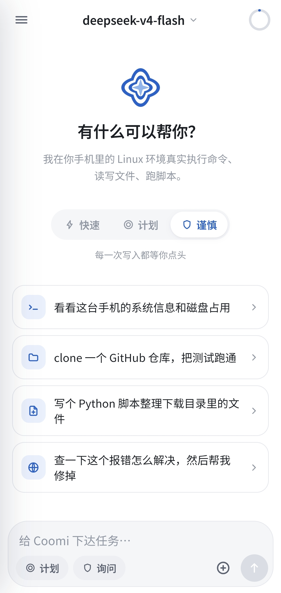
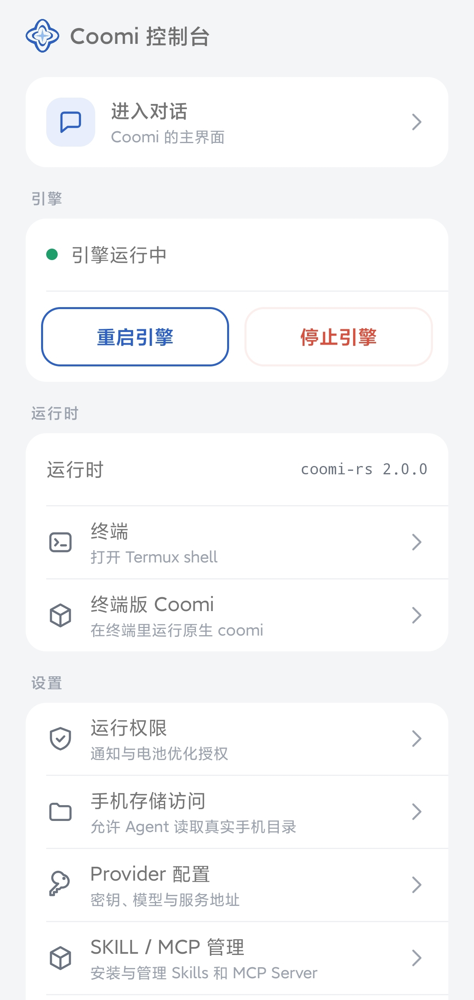
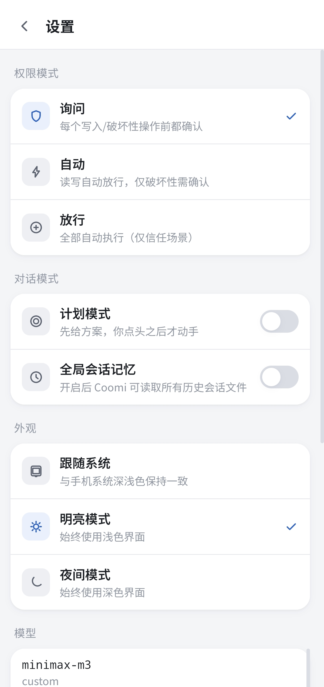
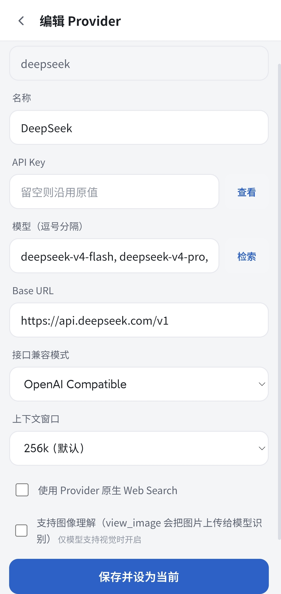

# Coomi

> **当前源码版本：v1.5.0-test.4（测试版）· 最新稳定版：v1.4.7**（Android ARM64）· [下载稳定版 APK](https://updates.septemc.com/coomi/android/Coomi-Android-arm64-v1.4.7.apk) · [GitHub Releases](https://github.com/TensorHub-ORG/Coomi/releases) · [官网](https://coomi.septemc.com/)
>
> v1.5.0-test.4 测试内容：会话运行过程恢复、上下文用量统计和终端主题等。测试版可能不稳定，不替代稳定版下载。

<table align="center">
  <tr>
    <td align="center" width="20%">
      
      <br />
      <sub><strong>TensorHub</strong><br />组织 LOGO</sub>
    </td>
    <td align="center" width="20%">
      
      <br />
      <sub><strong>Coomi</strong><br />Agent 吉祥物</sub>
    </td>
    <td align="center" width="20%">
      
      <br />
      <sub><strong>Coomi Agent</strong><br />项目 LOGO</sub>
    </td>
    <td align="center" width="20%">
      
      <br />
      <sub><strong>QQ 交流群</strong><br />扫码加入</sub>
    </td>
    <td align="center" width="20%">
      
      <br />
      <sub><strong>QQ 频道</strong><br />板块讨论</sub>
    </td>
  </tr>
</table>

<p align="center">

  
  
  
  
  
  
</p>

## 项目介绍

Coomi 是一款面向 Android 的 AI Agent 工作环境。可以用于手机上直接开发APK应用，快速处理文件，便携灵感落地等场景。它已将可配置的模型服务、可执行的终端环境与文件工具进行整合，让 Agent 能够在手机上运行命令、读写文件、处理图片，并通过 SKILL / MCP 扩展能力。所有的对话、会话记录和运行环境由设备本地管理；可自由配置模型提供商。

<p align="center">
  <a href="docs/assets/show_001.jpg"></a>
  <a href="docs/assets/show_002.jpg"></a>
  <a href="docs/assets/show_003.jpg"></a>
  <a href="docs/assets/show_004.jpg"></a>
</p>

## 主要功能

- **模型服务**：支持 OpenAI 兼容接口、Anthropic 和 Gemini，可自行设置服务地址、密钥和模型名称。
- **终端与文件**：提供 Android 本地终端和 Ubuntu 24.04 环境，可运行命令、管理文件，并使用 gcc、cmake 等构建工具。访问手机共享存储前需授予系统权限。
- **图片查看**：可将图片发送给支持视觉输入的模型，或自行配置图像理解MCP功能；图片可在应用内自由查看并保存。
- **SKILL 与 MCP**：添加 SKILL 或连接 MCP 服务；可以自由配置、AI自定义制作MCP与SKILL。
- **会话与执行记录**：记录功能状态稳定，各会话分别保存历史和草稿；运行状态、命令及输出会显示在对话中，切换会话或重新连接后可恢复查看运行过程。
- **长对话**：超长对话记忆稳定，支持整理上下文和分段加载历史；整理后持久保留完整会话记录。
- **协作工作室（实验）**：支持多种工坊用法，创建工作室、配置成员和模型，通过群聊分配任务，并在工单看板中跟进和审批。
- **DeepSeek 登录**：可使用 DeepSeek App 账号登录，并调用账号当前可用的订阅额度。
- **外观与本地数据**：支持跟随系统、明亮和夜间主题；升级会保留会话、运行环境与配置，卸载应用会清除设备上的本地数据。

## 快速开始

1. 从 [GitHub Releases](https://github.com/TensorHub-ORG/Coomi/releases) 或[官网](https://coomi.septemc.com/)下载最新稳定版 APK（`Coomi-Android-arm64-v1.4.7.apk`），安装到 Android 7.0+ 的 ARM64 设备。
2. 打开 App，完成引导：配置模型服务商（Provider）与 API Key，或先跳过、稍后在「对话设置 → Provider 配置」中填写。
3. 进入对话界面，向 Agent 下达任务——它可以执行命令、读写文件、识别图片、管理 SKILL/MCP。

> 升级请直接在 App 内「检查更新」或覆盖安装新 APK（若APP内置检查更新失败请下载安装包进行覆盖更新），会话记录、虚拟环境与 API Key 全部保留；卸载 App 会清空设备本地数据，非必要请勿先卸载再安装。

## 项目结构

```text
Coomi-Android/
├─ apps/coomi-app/        # Android 应用壳（Termux 环境、WebView、更新安装器）
├─ apps/coomi-rs/         # Rust 智能体引擎（engine / services / tools / ui）
│  ├─ engine/             # 会话、上下文、Agent 循环
│  ├─ services/           # Provider 适配与消息序列化
│  ├─ tools/              # 内置工具（shell、read_file、view_image、show_image、SKILL/MCP 管理等）
│  └─ ui/                 # coomi serve：本地 HTTP/WebSocket 服务
├─ apps/web/              # Vue 3 + Pinia 对话前端（打包为 web.zip 内嵌）
├─ assets/                # 项目 LOGO、吉祥物与组织 LOGO
├─ docs/assets/           # README 展示截图
├─ deploy/                # 发行部署（官网 index.html、更新源 latest.json、APK）
└─ tools/                 # 开发辅助脚本
```

## 文档

- [官网与下载](https://coomi.septemc.com/)
- [更新源](https://updates.septemc.com/coomi/android/latest.json)
- [GitHub Releases](https://github.com/TensorHub-ORG/Coomi/releases)

## 许可证

本项目采用 Apache License 2.0 许可证。详细条款请阅读 [LICENSE](LICENSE)。

## 作者与版权

Copyright 2026 Septemc and TensorHub.
