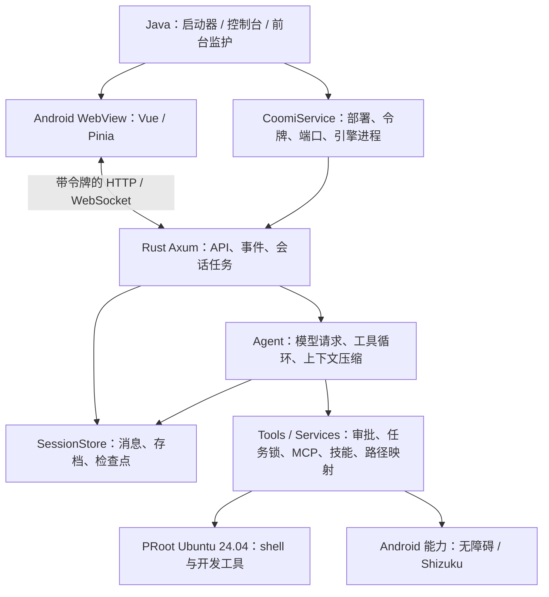

# Coomi Android 与 Comax 1.5.3 接入分析

分析日期：2026-10-18。范围：当前安卓工程、社区分支的实际代码差异，以及用户提供的《20261018-魔改版更新说明.txt》。本轮只做分析和参考源码提取，不修改业务代码。

**结论：值得吸收的是会话恢复、启动自修复、思考持久化、过程折叠、压缩反馈和上下文展示；接入单位应是功能补丁。云端访问、并发锁修改、电源键接管、极简模式均不能按社区版原样接入。** 更新说明中也有一些主线已经具备基础、或者实际实现达不到文案承诺的项目。

## 1. 比较基线与分析方法

| 项目 | 本次固定基线 |
| --- | --- |
| Coomi 工作区 HEAD | `f35af21dd0800b021eb6861822c3cf2317cd14d2` |
| Coomi 默认安卓版本 | `1.5.0-test.1`，versionCode `90`；以 Gradle 为准 |
| Comax main | `dbce1acbf6f8efbc69596826391811ff8a7d416a`，2026-10-17，1.5.3 / vc86 |
| 共同祖先 | `be2ac21dd7f4f534052adb244b55ee2ff7d890f6`，较早的 Comax 1.5.1o3 |
| 分叉后独有提交数 | Coomi 99 个，Comax 8 个 |
| 社区分支源码增量 | 相对共同祖先，Android `app/src`、Rust、Web `src` 三部分共 147 文件，增加 10,915 行、删除 860 行 |

这里的版本号来自两个分支各自的发布序列，不能用 `1.5.3 > 1.5.0` 判断代码整体先进程度。较早的 Comax 基础已经是当前 Coomi 的祖先；重复搬运其旧功能会覆盖主线之后的修复。

分析同时比较了「共同祖先 → 社区分支」和「当前工作区 → 社区分支」，并沿着事件、持久化、工具调用和 Android 启动路径核对实现。没有只根据发布文案或提交标题判断。

工作区原有未提交改动位于 `engine/src/agent.rs`、`services/src/provider.rs`、`services/src/skill_router.rs`、`web/src/components/Composer.vue`，分析时保留。这意味着后续移植必须以实际工作区为起点，尤其不能覆盖 Agent 和输入框。

已将固定 SHA 的相关源码与相对共同祖先的逐文件差异提取到被忽略的 `references/comax-20261018-analysis/`，其中 `manifest.json` 记录来源，`source/` 保存 154 个相关源码及文档文件，`delta/` 保存差异。本文中的社区源码链接均固定到上述 SHA，避免远程 main 后续变化影响结论。

## 2. 当前项目的架构与必须保住的行为

Coomi Android 是 **Java 安卓外壳 + Vue 3 / Pinia / WebView + 原生 Rust 引擎 + PRoot 工具环境**。Rust 引擎运行在 Android 宿主侧；Linux 工具负载进入 PRoot。不能把引擎本身理解成 Ubuntu 内的一段脚本。

主要边界如下：

- **构建与安装**：[app/build.gradle](../../apps/coomi-app/app/build.gradle) 把 Vue 产物打包为 `web.zip`，交叉编译 arm64 Rust 并以 `libcoomi.so` 部署，同时携带 PRoot/Ubuntu 资源。默认 minSdk 24、targetSdk 28、compileSdk 34；target 28 与应用私有目录中的 Termux 可执行程序有关，不能跟随普通安卓升级顺手提高。当前只构建 arm64。
- **原生生命周期**：[CoomiService.java](../../apps/coomi-app/app/src/main/java/app/coomi/CoomiService.java) 管理引擎进程、软链和资源；[CoomiEngineMonitor.java](../../apps/coomi-app/app/src/main/java/app/coomi/CoomiEngineMonitor.java) 提供前台监护、健康检查、重启熔断和通知。已有重启上限与稳定期，增加自修复时要接入这条生命周期。
- **连接和视图**：[session.ts](../../apps/web/src/stores/session.ts) 有按作用域创建的会话 store、辅助会话、最多 5 个连接的池、事件 ACK 与本地时间线兜底。主视图使用虚拟列表；[chatTimeline.ts](../../apps/web/src/utils/chatTimeline.ts) 特意复用块与数组引用，避免流式输出反复触发整表重算。
- **任务与连接分离**：[ui/src/web.rs](../../apps/coomi-rs/ui/src/web.rs) 中 `SessionTask` 的生命周期独立于 WebSocket，有任务槽、事件序号、待确认事件和审批状态。但一个任务的 `conn_tx` 目前只有一个活动发送端，并非多终端订阅系统。
- **执行与持久化**：Agent 驱动 provider 和工具；会话文件与 archive 保存历史，检查点决定已完成操作如何恢复；RuntimeManager/PathMapper 决定宿主与 guest 路径。界面恢复不能绕开执行检查点。

当前主线 [v1.5.0-test.1 更新说明](../releases/v1.5.0-test.1.md) 对应的重要行为已经在代码中形成约束：分段压缩、完整存档、压缩失败保留历史、取消私人会话记忆污染、每个工具后立即保存、保存失败停止任务、限定范围取消子 Agent、修改型工具批次串行，以及更严格的 XML 工具调用识别。社区版较旧的同名文件不能整体覆盖这些实现。

运行环境的事实应以构建资源和 runtime doctor 为准。部分旧环境文档仍写 Debian，而当前打包的是 Ubuntu Noble；移植提示词时要同时核对路径和环境契约。

## 3. 更新说明的 19 项逐条判断

优先级含义：P0 为可靠性基础；P1 为主要体验增量；P2 为可选体验；“独立专项”表示不应混入本轮杂项移植。这里的 P0 是建议顺序，不表示已经通过设备复现确定了故障发生率。

| # | 更新说明 | 当前 Coomi 的基础 / 差距 | 建议 |
| --- | --- | --- | --- |
| 1 | 黑白终端主题、等宽字体 | 已有主题与外观体系，缺少该预设 | P2：提取主题变量，同时适配原生外观和自定义样式优先级 |
| 2 | 云端浏览和继续会话、自动部署脚本 | 本地 HTTP/WS 已具备；公网身份、加密、权限与多终端协议未形成完整边界 | 独立专项：只参考交互方案，重做传输与授权 |
| 3 | Coomi 文案统一改 Comax | 属于 fork 品牌行为 | 不接入；保留 Coomi 品牌、包名、更新源及归属 |
| 4 | 模式按钮分裂、摊开、收回动画 | 已有模式面板；本地 Composer 正在修改 | P2：抽独立组件和局部动画，不覆盖 Composer |
| 5 | 多段思考与工具合成一个过程块 | 已有工具组和可复用时间线构造器 | P1：扩展为按任务轮次分组，最终回答留外部 |
| 6 | 思考显示 3.5 行、完成后折叠 | 已有 ReasoningBlock；社区实现用 900ms 静默猜完成 | P1：接入视觉规则，完成状态改由事件驱动 |
| 7 | 思考随会话持久化 | 实时有思考事件；历史消息缺少对应持久字段 | P1：贯通 Rust 消息、检查点、协议、历史还原，并修重试串段 |
| 8 | 上下文分段环和完整统计面板 | 已有分类估算、UsageDetails、BillingDetails、用量与推理统计 | P1：复用主线数据和组件；修单位、估算口径与图形比例 |
| 9 | 极简单句人设、shell/看图；普通模式保留工具输出首尾 | 已有极简限制、上下文裁剪和笔记权限 | 拆分：首尾裁剪 P1；极简提示词和工具集重新设计 |
| 10 | 工具与文字同步入场 | 已有流式渲染、虚拟列表 | P2：小范围样式适配，验证嵌套组件和列表测高 |
| 11 | 侧栏底图、对话卡片侧翻、改善流畅度 | 已有侧栏、手势、覆盖层和返回处理 | P2：提取 transform 动画，真机验证，不能仅凭文案认定性能提升 |
| 12 | 0.5 秒电源键唤醒、3 秒系统菜单 | 依赖整套默认助手、无障碍、录音和 ASR 链路 | 独立专项：先默认助手，后做默认关闭的实验性按键接管 |
| 13 | 进入会话不再闪动 | 现有缓存先画、历史再替换和异步恢复存在竞态空间 | P0：与快照、水位、一次定位一起接入 |
| 14 | 清理残留引擎进程 | 已有进程句柄、指纹、健康检测及单实例保护；丢失句柄后的识别需补强 | P0：精确归属识别后清理，拒绝宽泛字符串杀进程 |
| 15 | 部署标记恢复、健康后才算启动成功、失败重试与日志 | 仍有 marker 硬门槛；普通启动在进程创建后即可返回成功 | P0：贯穿启动器、安装页、Service 和监护链路 |
| 16 | 云端配置页不重叠、脚本折叠、数字端口 | 主线尚无这套云端页 | 跟随云端专项；布局技巧可复用，不单独引入整页 |
| 17 | 关闭更新提醒 | 主线是正式/测试双通道与静默红点，和 fork 单通道行为不同 | P2：按主线“提醒/红点”的语义加开关，手动检查保持可用 |
| 18 | 切换会话不停止、多会话并行 | 后端任务已独立于连接；后台事件 ACK 后未入视图、工作区锁过粗是两个不同问题 | P0：分别修恢复和调度；不接入会话化 Git 锁 |
| 19 | 压缩完成立刻展示摘要、重进不重复弹出 | 已有更完善的压缩和 archive 逻辑；实时摘要反馈可补 | P1：加摘要事件与去重标识，保留历史摘要入口 |

## 4. 可靠性部分：最有价值，也最容易误合并

### 4.1 引擎启动自修复：建议优先吸收

主线 `CoomiService.isDeployComplete()` 主要依赖部署标记；`ensureNativeBinaryLinkCurrent()` 在标记缺失时就无法完成修复。普通 `startEngineSync()` 在创建进程后便可返回启动成功，健康等待主要出现在后续 Runtime 安装路径。这会把“进程创建成功”和“服务真正可用”混在一起。

社区版 [启动与修复代码][F-service] 有可借鉴的闭环：重建最小运行目录、刷新二进制软链、执行 `--version` 校验后补标记；每次最多等 12 秒，300ms 轮询健康；失败带日志尾部重试一次；日志超过 8MiB 时保留约 1MiB 尾部。启动成功以健康响应为准，方向正确。

但需要调整四处：

1. **修复入口要早于 marker 分流。** 主线 Launcher 和 InstallFragment 也检查部署标记。仅在 Service 中补修复，用户可能仍先被导向安装界面。
2. **保留主线工作目录。** 主线使用 `$HOME/coomi`，社区启动命令改成 home；照抄会让项目指令、文件相对路径、Git 和会话 cwd 改变。
3. **残留进程须验证身份。** 社区 `/proc` 扫描只看 cmdline 是否包含 `libcoomi.so` 或 `/runtime-v2/`，没有显式核对 UID、精确可执行路径和引擎实例归属。Android 权限通常会阻止跨 UID 发信号，但同 UID 的用户终端/合法工具仍可能误中；读取命令行的能力也受系统版本影响。应结合持久 PID、进程开始时间、可执行路径/实例指纹和受控进程组识别，避免把整个运行时进程都当成残留。
4. **复用现有监护约束。** 保留重启熔断、线程中断与销毁处理、Runtime 资源不足时的非致命降级、Shizuku 与反馈链路，并为同一时刻的启动请求保留统一入口。补 marker 不代表重装或清空会话。

### 4.2 后台恢复：应引入视图快照，而不是只隐藏页面

主线 [session.ts](../../apps/web/src/stores/session.ts) 约 230 行起的逻辑明确写着：后台会话事件继续 ACK，但仅当前会话调用 `onInbound()`。因此 **“引擎继续执行”和“返回时能够完整显示进行中状态”是两件事**。后台的中间思考、工具状态已被确认接收，却未应用到该视图；未完成流也不一定已落成最终消息。

社区 [ViewCheckpoint 与 snapshot 接口][F-snapshot] 的设计值得吸收：

- 后端保存视图基准、增量事件和事件序号水位，ACK 不直接删除视图恢复所需信息。
- 前端暂存隐藏期间事件，恢复时先取快照，再仅应用高于水位的事件。
- 持久化前进时同步推进视图基准，避免重放基准中已包含的用户消息和工具结果。
- 恢复期间先布局并完成一次滚动定位，再显示内容，减少缓存与历史两次置底的闪动。

接入时增加 session/request generation 或 AbortController，防止 A→B→A 快速切换时旧请求把新会话覆盖；队列同时按事件数和字节数限制，不能只照抄 3000 条上限。保留审批、提问、取消、错误、stream reset、usage 和附件事件；主会话与辅助会话均按自己的作用域恢复。

**视图快照仍是内存中的展示状态，不能代替磁盘检查点。** 社区持久化回调有保存失败后只记录日志继续前进的旧行为；主线 `.with_durable_checkpoint()` 与“保存失败停止执行”必须保留。快照基准、水位、事件裁剪还需要在同一明确的并发约束下更新。

### 4.3 多会话并发：问题成立，社区解法不成立

主线 `begin_managed_task()` 使用全局 `state.cwd` 申请整轮 Workspace 写锁和 Git 写锁；实际会话 cwd 则稍后才加载。因此同默认目录的任务会相互串行，甚至不同会话 cwd 也可能先争同一把全局锁。前端池有 5 个连接、后端有多个任务槽，并不能消除这层串行。

社区 [并发修改][F-locks] 把 Workspace 与 GitRepository 的 key 都改为 `cwd#session_id`。这让不同会话获得不同锁，代价是同一目录与 Git 索引失去了跨会话互斥保护。

代码注释说 `ConflictBaseline` 可以兜底，但调用实际是 `capture(&state.cwd, &[])`：[task_manager.rs](../../apps/coomi-rs/services/src/task_manager.rs) 只有显式传入的普通文件才记录哈希，空数组主要留下 Git HEAD/index 与若干 lockfile 状态；它不是任意文件的冲突检测，也不是工具执行中的互斥锁。

建议把两类锁分清：一个会话同一时刻只跑一轮，由 session/task 状态约束；共享工作区、真实 Git 仓库和修改操作按实际资源互斥。先解析真实会话 cwd，再决定资源；模型等待和读取允许并行，写入及 Git 状态修改串行或进入隔离 worktree。既不能保持全局整轮粗锁，也不能通过给共享资源锁加 session 后缀来实现并发。

## 5. 思考与时间线：适合形成一个完整体验批次

### 5.1 思考持久化：字段小，链路长

社区 [ChatMessage.reasoning][F-types] 使用 serde 默认空值兼容旧文件；[Agent 流回调][F-agent] 收集 reasoning delta，成功得到 assistant message 时写入；前端还原历史时重建思考块。方向合理，且思考不应因此重新作为普通 content 发送给模型。

发现的具体缺陷：`reasoning_sink` 在 provider 重试循环外创建，而模型重试、图像降级时 `StreamReset` 没有同步清空它。界面被重置后，落盘内容仍可能混入失败尝试的思考。取消或错误发生在成功响应之前，当前方案也不能保证保存进行中的思考。

移植需要明确以下语义：

- 每次请求尝试拥有独立缓冲；重试清理旧尝试，工具轮次之间不误串段。
- 对成功、失败、取消分别定义持久化时机，部分内容带完成状态并设大小上限。
- 字段贯穿 Rust 所有消息构造点、SessionStore/archive、检查点、前端类型和历史还原。
- 持久化思考不等于向 provider 发送思考；压缩输入、项目记忆、导出也应明确是否包含。
- 兼容没有该字段的旧会话，以及编辑、重试、截断后不再有效的旧思考。

### 5.2 过程折叠：复用时间线，不重写聊天页

社区新增 [ProcessBlock.vue][F-process]，并扩展 [chatTimeline.ts][F-timeline]：连续的思考、工具和中间 assistant 文本进入过程块，最后 assistant 回答放在外部，运行中展开，结束后折叠。是本次最直观的体验提升之一。

但“连续项”只是启发式：notice/question 会打断分组，流式回答在后面又出现工具时可能重新归类，出错/取消也不一定存在最后一条回答。建议用明确的 turn 标识和运行阶段判断归属；审批和需要用户回答的控件保持可见。

主线已有虚拟列表、缓存引用和辅助会话共享 TimelineBlock 的结构，适合在该层扩展。所有块要使用当前 SessionScope 的运行状态，避免辅助会话因主会话结束而自动收起。附件、图片、制品入口和稳定 key 都要保留。

### 5.3 3.5 行预览：提取样式，修正完成判断

社区 [ReasoningBlock.vue][F-reasoning] 用 900ms 内容不增长判定思考完成，遇到网络停顿会提前折叠；`split('\n').slice(-4)` 按换行符取四行，也不等于手机屏幕中的 3.5 个视觉行。

应由协议中的轮次/阶段结束驱动折叠，使用真实 line-height、容器高度和渐隐遮罩实现视觉预览。用户手动展开的状态应有明确保留规则。过程块与内部思考块避免同时折叠导致跳动，并遵循关闭动画和系统减少动态效果设置。

## 6. 上下文展示、裁剪与压缩

### 6.1 分段环可以接，统计口径需要先修

主线已有 `UsageDetails.vue`、`BillingDetails.vue`、后端 `context_categories`、缓存统计与推理强度统计。社区主要增强展示，不是从零引入一套用量引擎。应扩展这些组件，避免把社区的大段内联 TopBar 替换进来，丢掉主线模型能力分组与返回键管理。

社区 [TopBar.vue][F-usage] 存在可以直接从字段追踪确认的问题：后端工具 `elapsed` 来自 `as_secs_f64()`，前端却直接相加为 `toolElapsedMs`，再交给毫秒格式化函数。按当前字段语义，12 秒会被显示成 `12ms`。需要在协议边界显式统一秒/毫秒。

另外，分类来自估算，不能当作精确、实时、互斥的账目：后端有按字节近似 token 的分类估计，技能等内容可能已经包含在系统提示词中；会话累计 token 与本次上下文实际占用不是同一指标。社区按大小排序后分配颜色，会使同一类别颜色变化，最小 0.8% 可见弧和间隔又会扭曲小分段比例。

建议固定“类别→颜色”，区分容量占比与已用组成，标明估算，对未知/重叠部分处理清楚；视觉最小标记和真实数值分离。历史缺少耗时、零窗口、缓存数据未知时显示缺失状态，不能编造精确统计。

### 6.2 工具输出保留首尾：建议单独提取

社区 [prune_oversized_tool_results()][F-pruner] 对超过 8192 字符的单条工具结果保留头 4096、尾 1024 字符和省略说明，作用于发给模型的请求副本，完整持久化记录不因此丢失。比提前把整条结果替换成一句话更有用。

但不能照单全收：社区调用并未严格限定“普通模式”；固定字符阈值不随模型预算调整；报错或关键证据也可能就在被删的中间。适合做按模式/预算的策略，保留最近关键工具结果，并提供原结果路径或分段读取方式。图片和结构化协议内容需单独处理。主线紧急超窗保护仍需保留。

更新说明称旧逻辑“一超限就把所有工具输出抹掉”也不准确：现有 trim 是逐条改写、达到预算就停止。不能据这句文案推导出应该移除整个主线上下文保护流程。

### 6.3 极简模式：当前社区“看图”实际上不通

社区 [工具 schema 与执行门禁][F-minimal-tools] 不一致：schema 在极简模式暴露 `shell` 和 `show_image`，执行入口却拒绝所有非 `shell` 调用。即使去掉该拒绝，`show_image` 的语义也是把图展示给用户；供模型理解图片的是 `view_image`。

此外，单句人设的早返回跳过了重要环境/路径说明。Coomi 同时存在 Android 宿主、PRoot、工作区和受控系统能力，缺少这些事实会提高错路径和无效命令概率。主线现在还有按当前用户引用授权 `read_note` 的逻辑，应保留。

建议把“少提示词/少工具”的模型预设与权限等级分开：极简并不意味着较低权限，现有映射中可能仍是 FullAccess。保留最小环境契约，按真实需求选择 `shell`、`view_image` 和授权笔记，并保证 schema、执行门禁与说明三者一致。

### 6.4 压缩摘要即时出现：只提取反馈协议

社区给 `CompactionCompleted` 增加 summary，并在前端 compression 事件中立即显示详情，这个增量有价值。但它同时让历史还原完全跳过压缩摘要，用户重进后也失去查看摘要的入口。

推荐使用压缩标识或会话 revision 去重：本次压缩结束立即呈现；重连和重进不重复触发提醒；历史中仍能打开摘要。主线分段压缩、完整 archive、后续消息合并去重、失败保留原历史和进度显示全部保留。社区旧 `trim_compacted_history` 还有“注释说保留最新、实际按首次找到保存”的问题，不能顺手替换整条压缩管线。

## 7. 云端访问：产品方向可用，现有实现不适合上线

实际实现由 [cloud.rs][F-cloud]、[cloud_tunnel.rs][F-tunnel]、[cloud_relay.cjs][F-relay] 和设置页组成：手机主动连接服务器，Node 中继把浏览器连接转回手机本地引擎。虽然部分注释写 SSH，运行代码使用的是自定义多路复用 TCP，并没有建立 SSH 隧道。

以下均是源码可确认的边界问题，不是已部署环境中的漏洞复现：

| 发现 | 实现依据与影响 |
| --- | --- |
| “不能改配置”未覆盖 WebSocket | HTTP 白名单放行 GET `/ws/`，升级后仍进入完整 `handle_command`，连接上下文没有远程角色。`set_permission_mode` 等配置命令仍在该命令面中，前端连接后还会自动发送部分配置命令 |
| 云端管理接口自身允许写入 | `cloud_request_allowed()` 放行所有 `/api/cloud-access*` 写请求，超出了“允许关停”的范围，可触及云端完整配置 |
| 远程身份依赖可伪造请求头 | 云端判定看 Host/Origin，未知或缺失则不套远程限制；通过直接中继构造请求时不能把这些头当作可信身份。此问题以已经持有有效引擎令牌为前提，并不等于无令牌绕过认证 |
| 与本地共用完整权限 token | 访问 URL 复用本地引擎令牌，缺少独立权限、吊销与生命周期；还可能随引擎重启失效 |
| 手机到服务器链路没有 TLS | `TcpStream` / `net.createServer` 加 nonce+哈希身份握手，只解决一部分握手认证，未加密后续会话和 bearer。浏览器到 nginx 的 HTTPS 无法保护这第二段链路 |
| 部署脚本与访问 URL 不一致 | URL 可生成 `https://domain`，脚本却只有 nginx `listen 80`、未配置证书；中继密码仍是“（Comax 里填的密码）”占位符，不是实际配置，因此并非完整即用部署 |
| 停止并非立即断链 | `request_stop` 仅改标志，持续运行的 `pump_once()` 没有对应取消等待；状态停止与连接真正关闭可能脱节 |
| 本地和远程不能可靠同时订阅 | `SessionTask.conn_tx` 仍是单发送端，新连接会替代活动订阅；缺少独立 ACK、水位和多观察者分发 |

发送消息本身也能触发 shell 等工具。因此未来需要明确区分“只能看聊天”“可发消息并执行任务”“可审批工具”“可管理配置”，不能把“能发消息”叫作对手机只读。

建议作为单独功能设计：加密且认证服务器身份的连接、独立可吊销的远程凭据、HTTP 和 WS 共享的身份/能力检查、会话与工具权限范围、多端事件订阅、可取消的隧道，以及实际可用的证书/部署方案。服务器脚本还需对输入做正确引用与校验。当前可复用的是页面流程和状态信息组织，原始传输及权限方案不进入主线发布。

## 8. 默认助手与电源键：拆成两个阶段

社区新增 VoiceInteractionService/Session、设置入口、录音、转写 API 和可选系统 SpeechRecognizer。它既是系统默认助手功能，也涉及把音频交给配置的 ASR 服务；不是只加一段按键监听。

[无障碍电源键接管][F-power] 在收到 KEYCODE_POWER 时消费按下/抬起，500ms 唤醒、3000ms 调系统电源菜单，短按使用 `GLOBAL_ACTION_LOCK_SCREEN`。后者需要 API 28+，而 Coomi minSdk 是 24；不同 ROM 是否把电源键交给无障碍服务也不能保证。系统快捷操作、熄屏/锁屏、权限撤销和服务死亡都影响行为。

还有一段在短时间内见到 systemui/android 就调用全局 Back 来消掉系统电源菜单的逻辑，并没有精确识别菜单，可能干扰其他系统界面。`RecognitionService` 本身还是返回错误的占位实现，真正语音路径在自有录音/转写中；不能据声明推导出完整系统语音识别兼容性。聊天模型服务也不必然支持 `/audio/transcriptions`。

更合适的顺序是先做官方默认助手入口、权限说明与可靠的录音/转写；电源键接管后续作为默认关闭的实验项，具备明确回退，并在 API 24/28+ 与目标 ROM 上实测。不能对所有机型承诺“0.5 秒接管且短按完全一致”。

## 9. 主题、动效与更新提醒的接入边界

终端主题可以提取为预设，覆盖消息/工具/思考的颜色、代码区和原生状态栏。需要确定与用户自定义样式的优先级；CSS monospace 在中文字形回退时并不必然全等宽，不宜无字体验证就承诺“全等宽”。

模式动效依赖按钮测量、多组定时器和面板状态，社区还使用全局 `.querySelector('.sbar')`，主线多 Composer/辅助会话场景可能取错元素。应使用局部 ref，清理快速连点、视图卸载、键盘变化和旋转时的动画状态。该文件本地已有改动，适合拆组件后接入。

侧栏与入场动效的性能收益尚未真机验证。社区侧栏某些布局仍存在 scale，scoped `.cascade` 对嵌套组件的匹配也需要检查；主线虚拟列表还会因高度变化重新测量。接入必须保留手势冲突处理、系统返回、右侧制品与全局关闭动画设置，重点测长会话和低性能 WebView。

更新提醒方面，主线有 `updates.septemc.com` 的正式/测试双通道和静默红点，目前没有发现与社区相同的启动自动弹窗调用。可加“更新提醒”偏好控制红点/提示，但保留手动检查和通道选择。不能复制 fork 的单通道更新页、第三方源、版本号或 vc86，尤其不能造成主线 versionCode 倒退。

## 10. 更新说明之外的 1.5.2 增量

八个社区独有提交还夹带这些功能，值得知道，但不应隐式带入本轮范围：

| 功能 | 判断 |
| --- | --- |
| MCP 表单、测试与重启 | 可作为后续增量；主线已有 JSON 导入、目录安装和启停，应保留现有接口、密钥掩码与能力探测 |
| 完整计划步骤同步 | 有价值；主线 PlanUpdated 更接近活动步骤映射，可单独补完整步骤状态，避免把循环进度当任务计划 |
| “关闭思考” | 社区部分实现只是不再传 reasoning 参数，不能保证关闭默认开启推理的模型；优先使用主线真实模型能力探测 |
| 笔记库、持久记忆调整 | 主线已有私人笔记权限与上下文同步修复，不能退回 fork 按旧消息文本查引用的实现；记忆注入应单独评估 |
| 动态工作流库 | 是较大功能，包含 Node vm、world 门面和 journal；主线也已有 workflow/task/approval 基础。不能把 Node vm 当安全隔离，执行路径需接 RuntimeManager/PathMapper，事务和重放语义另审 |
| DAU 上报移除、币种/其他服务调整 | 属于独立产品决策，与本次 1.5.3 功能提取无必然关系 |

## 11. 建议的接入批次与验收

**第一批：可靠性底座。** 启动健康闭环、部署标记修复、准确的残留识别；后台快照、水位和恢复竞态；并发调度单独设计。第一批不需要绑定主题或助手发布。

**第二批：思考与压缩体验。** 思考持久化及重试清理 → 事件驱动的思考状态 → 过程折叠；压缩即时摘要与历史去重。先固定消息和事件语义，再做视觉聚合，避免把丢失状态掩盖在折叠效果里。

**第三批：展示与上下文效率。** 修正统计单位和估算口径 → 分类环/面板；首尾裁剪独立策略；主题、更新提醒与可关闭的动效。

**第四批：独立能力。** 默认助手、实验性电源键、重新设计后的远程访问分别进入自己的迭代。

| 范围 | 接入时有判别力的验收 |
| --- | --- |
| 启动/更新 | 删除 marker、软链过期、引擎秒退、健康超时、连续点击启动、旧进程存在、空间不足；检查会话不丢、不会误杀用户终端、熔断仍有效 |
| 恢复 | A→B→A 快切、运行时后台/前台、断网重连、超过缓存上限、应用与引擎分别重启；检查用户消息/工具/审批不丢不重，进行中状态正确 |
| 并发 | 不同 cwd 并发推进；同目录同时改同文件和 Git 操作不会无保护交错；取消 A 不杀 B 或其他会话子任务 |
| 思考/时间线 | 多工具轮次、无最终回答、错误/取消、provider 重试、图像降级、旧会话、辅助会话、附件、长会话；折叠后最终回答和审批仍可访问 |
| 压缩 | 手动/自动、失败与空摘要、压缩后追加、重启后历史；原文 archive 保留，摘要一次提醒且历史可查看 |
| 统计/裁剪 | 秒和毫秒、零窗口、未知缓存、超长中文/JSON、证据在中段；不修改原始工具记录，不把累计 token 当上下文用量 |
| 远程专项 | 用有效远程身份实际尝试 HTTP 和 WS 配置命令、工具执行/审批范围、两端同时观看、吊销与断链、证书与部署脚本；不能只检查设置页是否隐藏按钮 |

## 12. 已完成验证与边界

- 当前工作区 Web 测试：`npm run test`，**24/24 通过**。
- 当前工作区类型检查：`npm run type-check`，`vue-tsc --noEmit` **通过**。
- 已核对 Git 血缘、社区独有提交、实际源码路径、主要消息/状态流，以及本文列出的关键缺陷。
- 本轮没有执行社区服务器部署脚本，没有部署公网服务，没有修改业务源码或生成发布 APK。未做 Android 真机、电源键、Rust/NDK 全量构建和改动后回归；上述测试是当前主线基线，不证明未来移植已经可用。

后续应按功能生成小补丁并沿用原有署名和许可证说明；不整包 merge 八个混合提交，不整文件替换高耦合模块，也不把 fork 品牌、更新源和版本配置带回 Coomi。

[F-service]: https://github.com/maxtwin114514/comax/blob/dbce1acbf6f8efbc69596826391811ff8a7d416a/apps/coomi-app/app/src/main/java/app/coomi/CoomiService.java#L480
[F-snapshot]: https://github.com/maxtwin114514/comax/blob/dbce1acbf6f8efbc69596826391811ff8a7d416a/apps/coomi-rs/ui/src/web.rs#L335
[F-locks]: https://github.com/maxtwin114514/comax/blob/dbce1acbf6f8efbc69596826391811ff8a7d416a/apps/coomi-rs/ui/src/web.rs#L517
[F-types]: https://github.com/maxtwin114514/comax/blob/dbce1acbf6f8efbc69596826391811ff8a7d416a/apps/coomi-rs/engine/src/types.rs#L123
[F-agent]: https://github.com/maxtwin114514/comax/blob/dbce1acbf6f8efbc69596826391811ff8a7d416a/apps/coomi-rs/engine/src/agent.rs#L438
[F-process]: https://github.com/maxtwin114514/comax/blob/dbce1acbf6f8efbc69596826391811ff8a7d416a/apps/web/src/components/ProcessBlock.vue
[F-timeline]: https://github.com/maxtwin114514/comax/blob/dbce1acbf6f8efbc69596826391811ff8a7d416a/apps/web/src/utils/chatTimeline.ts
[F-reasoning]: https://github.com/maxtwin114514/comax/blob/dbce1acbf6f8efbc69596826391811ff8a7d416a/apps/web/src/components/ReasoningBlock.vue#L18
[F-usage]: https://github.com/maxtwin114514/comax/blob/dbce1acbf6f8efbc69596826391811ff8a7d416a/apps/web/src/components/TopBar.vue#L71
[F-pruner]: https://github.com/maxtwin114514/comax/blob/dbce1acbf6f8efbc69596826391811ff8a7d416a/apps/coomi-rs/engine/src/context.rs#L322
[F-minimal-tools]: https://github.com/maxtwin114514/comax/blob/dbce1acbf6f8efbc69596826391811ff8a7d416a/apps/coomi-rs/tools/src/lib.rs#L2718
[F-cloud]: https://github.com/maxtwin114514/comax/blob/dbce1acbf6f8efbc69596826391811ff8a7d416a/apps/coomi-rs/ui/src/cloud.rs#L212
[F-tunnel]: https://github.com/maxtwin114514/comax/blob/dbce1acbf6f8efbc69596826391811ff8a7d416a/apps/coomi-rs/ui/src/cloud_tunnel.rs#L108
[F-relay]: https://github.com/maxtwin114514/comax/blob/dbce1acbf6f8efbc69596826391811ff8a7d416a/apps/coomi-rs/ui/src/cloud_relay.cjs#L180
[F-power]: https://github.com/maxtwin114514/comax/blob/dbce1acbf6f8efbc69596826391811ff8a7d416a/apps/coomi-app/app/src/main/java/app/coomi/CoomiAccessibilityService.java#L168
